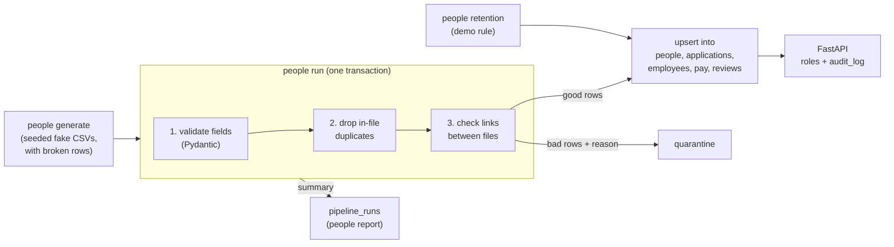

# people-data-pipeline

A learning project: a small "people data" backend built on **synthetic data only**.
Fake hiring, HR, payroll and performance-review files go through a tested Python pipeline
into one Postgres database, with a small access-controlled API on top.

It is a practice project, not any real company's system. It has never
handled real people's data, and it is not production software.

## Architecture



| Part | File | What it does |
|---|---|---|
| Schema | `people/schema.sql` | All tables. `people` is the only one with names and emails. |
| Generator | `people/generate.py` | Same seed gives identical files. Appends 5 broken rows per file. |
| Validation | `people/models.py` | One Pydantic model per file: types, required fields, ranges, allowed values. |
| Pipeline | `people/pipeline.py` | Validate, quarantine with a reason, upsert, store a run summary. |
| API | `people/api.py`, `people/auth.py` | Demo tokens, four roles, audit log. |
| Retention | `people/retention.py` | Blanks old rejected candidates' name and email. |
| Command line | `people/cli.py` | `people init-db / generate / run / report / seed-users / retention` |

## Run it locally

Needs Python 3.12+, [uv](https://docs.astral.sh/uv/) and Postgres. On a Mac:

```bash
brew install postgresql@17 && brew services start postgresql@17
export PATH="/opt/homebrew/opt/postgresql@17/bin:$PATH"   # Homebrew keeps these tools off PATH
createdb people && createdb people_test
uv sync
cp .env.example .env   # then put four long random tokens in it (the file shows how)
uv run pytest
```

Connection settings come from `DATABASE_URL` and `TEST_DATABASE_URL` (defaults: the local
`people` and `people_test` databases). `uv run --env-file .env ...` loads them from `.env`.

## How to demo this in 2 minutes

```bash
# 1. Clean start: wipes the local database. Needed after a retention demo, because
#    blanked names are never restored by the pipeline.
uv run people init-db --reset
uv run people generate

# 2. The pipeline: 5 bad rows per file quarantined, each with a reason.
uv run people run 2>/dev/null

# 3. Idempotency: run again, and the loaded counts are identical.
uv run people run 2>/dev/null | head -8

# 4. The API (second terminal): uv run --env-file .env uvicorn people.api:app
uv run --env-file .env people seed-users
set -a; source .env; set +a
curl -s -H "Authorization: Bearer $DEMO_TOKEN_MANAGER" "localhost:8000/people/P0009/journey?reason=team_planning"  # 200: direct report, no pay
curl -s -H "Authorization: Bearer $DEMO_TOKEN_MANAGER" "localhost:8000/people/P0150/pay?reason=team_planning"      # 403: other team's pay
curl -s -H "Authorization: Bearer $DEMO_TOKEN_VIEWER"  localhost:8000/insights/hiring-channels  # 200: aggregate only
psql people -c "SELECT at, username, action, person_id, outcome FROM audit_log ORDER BY id"

# 5. Retention (demo rule).
uv run people retention --days 180 --dry-run
uv run people retention --days 180
```

Interactive API docs with an "Authorize" button are at `http://localhost:8000/docs`.

## The data

Four CSV files, linked by one `person_id`:

| File | What it holds |
|---|---|
| `applications.csv` | Every candidate: name, email, source channel, stage, hired flag, dates |
| `hr_records.csv` | Hired people only: team, role, manager, start date, status |
| `payroll.csv` | Monthly pay periods with made-up amounts |
| `reviews.csv` | Performance reviews: cycle, rating 1-5, reviewer, date |

Each file gets 5 deliberately broken rows: duplicates, missing fields, bad dates, IDs that do
not exist elsewhere, out-of-range values, and a hired flag that contradicts the stage. Emails use
the reserved `example.com` domain.

The generator gives referral and university hires a small, invented boost to their review
ratings. With the default 150 people the samples are so small that random noise hides it (at
seed 42, referral actually ranks fourth). Generate a few thousand people and it shows clearly.
That is exactly why the API labels the metric as a simple demo with small samples.

## The pipeline

`people run` reads the files in dependency order (applications, HR records, then payroll and
reviews) and, for each row:

1. **Validates its fields** with Pydantic.
2. **Drops duplicates** inside the file (the first copy wins).
3. **Checks links** to the other files: an HR record must belong to a hired applicant, pay and
   reviews to an employee, and managers and reviewers must exist.

A failing row goes to `quarantine` with the first reason it failed. Names and emails are left
out of the stored copy: the file name and line number are enough to find and fix the row, so the
quarantine never becomes a second, forgotten copy of personal data. Good rows are **upserted**
(`INSERT ... ON CONFLICT DO UPDATE`), so rerunning the same files changes nothing. The whole run is
**one database transaction**: it lands completely or not at all (there is a test that crashes a
run halfway and checks nothing was saved). Each run's summary is stored in `pipeline_runs` and
printed by `people report`. Logs are one JSON object per line on stderr.

## The API (demo authentication)

Authentication is **demo only**: four seeded users, each with a static bearer token from an
environment variable. Only a SHA-256 hash of each token is stored, and each token expires
(`people seed-users --days N`, default 30). An expired token is refused like a wrong one.

| Endpoint | people_admin | manager | viewer | employee |
|---|---|---|---|---|
| `GET /people/{id}/journey` (application, hire, pay, reviews in date order) | anyone, with pay | direct reports only, without pay | 403 | 403 |
| `GET /people/{id}/pay` | yes | 403 | 403 | 403 |
| `GET /me/access-log` (who opened **my** record, when, why) | 403 (no person) | yes | 403 (no person) | yes |
| `GET /insights/hiring-channels` (aggregate, demo metric) | yes | yes | yes | yes |

The database itself refuses to change or delete `audit_log` rows (a trigger), so a bug or a
careless query in the app cannot rewrite history.

`/me/access-log` lets people see who has looked at their own record, including denied attempts.
Being able to check builds trust, and it makes misuse more likely to be noticed.

Opening a person's record needs a reason (`?reason=` one of `performance_review`,
`team_planning`, `hr_query`, `payroll`). A missing or unknown reason gets 422 before any data is
read. The reason is saved with the audit row, so a reviewer can ask "was this access justified?".

Every read of person data, allowed or denied, writes a row to `audit_log` (who, role, what,
which person, when, outcome, reason). A missing or wrong token is logged too, as a `failed_login` row
(the token itself is never stored), so repeated guessing shows up. A manager asking for someone outside their team gets 403 even if
that person does not exist, so the API does not reveal who is in the system.

## Retention (demo rule)

`people retention --days N` blanks the name and email of rejected candidates whose decision is
more than N days old (default 180), and records when. `--dry-run` only reports the count. The
application row stays, so hiring statistics still work, and later pipeline runs never refill
blanked details. **This is a demo rule for a learning project, not a legal or compliance claim.**
Real retention periods depend on law and company policy.

## Tests and Continuous Integration

`uv run pytest` runs 31 tests against a real Postgres: validation and quarantine reasons,
idempotent reruns, a failed run leaving no half-loaded data, access control (including "a
manager cannot see another team's pay"), audit rows, and retention (including "a rerun does not
refill blanked data").

GitHub Actions runs ruff (lint and format) and pytest on every pull request and on `main`, with a
Postgres service container. Actions are pinned to commit SHAs (Dependabot proposes updates), the
workflow token is read-only, and a new push cancels the branch's older run.

## Not built

Said plainly, so nobody assumes otherwise:

- **No scheduled pipeline run.** The pipeline only runs when someone types `people run`.
- **No automatic token rotation.** Tokens expire (30 days by default), but new ones are only
  issued when someone runs `seed-users` again. There is no login, no identity provider, and no
  multi-factor authentication.
- **Rows that disappear from a source file are not deleted** from the database. Each run only
  adds and updates.
- **Employees cannot read their own record**, only see who opened it.
- **No lockout or rate limiting after failed logins.** They are logged, but nothing stops
  someone from trying again.
- **`quarantine`, `audit_log` and `pipeline_runs` grow forever.** Nothing deletes old rows.
- **Access control lives only in the API code.** Anyone with direct database access sees
  everything. No Postgres row-level security, no column encryption for pay.
- **The audit log is append-only, not tamper-proof.** A database trigger refuses edits and
  deletes, but a database owner could remove the trigger. An insert-only database role for the app,
  or copying the log to a separate system, would close that gap.
- **No migration tool.** Schema changes mean recreating the database.
- **No front end, no AI features, no deployment, no pagination, rate limiting or connection pooling.**
- **The hiring-channel metric is a simple demo**: small samples, no adjustment for team, role or
  tenure, and no causal claim.
